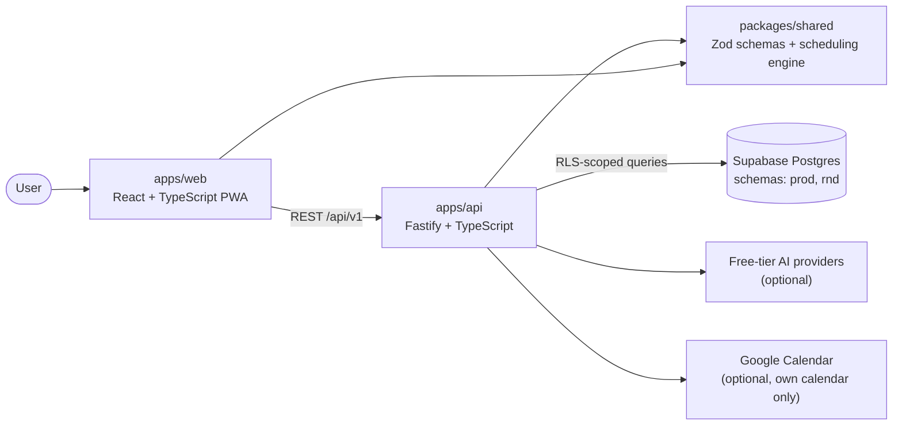

# Skillstack

*Build your skills, one block at a time.*

Skillstack is a web app (PWA) that turns a learning goal into a study plan – courses, certificates and practice sized to the time you have – and then runs that plan day by day: what to do today, practice sessions, an end-of-day review, and automatic rescheduling based on what actually happened.

> **Status: early development.** Phase 0 (environments) is next. This README grows with each release.

## Why

Study plans usually fail on the second day: something takes longer, something comes up, and the plan is out of date. Skillstack treats the plan as an ordered task list plus daily capacity, and reschedules from today onward after every change.

## Roadmap

| Phase | What | Status |
|---|---|---|
| 0 | Environments: `main` / `rnd`, CI, two database schemas, deployments, backups | Next |
| v0.1 | Foundation: accounts with row-level security, data model, scheduling engine, tasks API, minimal UI | Planned |
| v0.2 | Daily experience: dashboard, day briefing, day review, adjustment rules | Planned |
| v0.3 | Practices: in-app practice with free AI models and provider fallback | Planned |
| v0.4 | Content, plan and admin console | Planned |
| v0.5 | Plan builder: catalog, guided intake, plan generation | Planned |
| v0.6 | Google Calendar with minimal scopes and a write guard | Planned |
| v1.0 | Showcase: PWA, demo mode, metrics, full README | Planned |

## Architecture (planned)



## Principles

- **$0 to run.** Free tiers only; AI is an optional extra and every AI feature has a template or rule-based fallback.
- **Privacy first.** Row-level security on every user-owned table; no personal details sent to AI models.
- **Honest data.** Catalog entries carry verification flags; anything unconfirmed shows a "needs check" badge.
- **Suggestions, not surprises.** Plan changes are proposals the user approves.

## Repository layout

```
apps/web/           React + Vite + Tailwind PWA
apps/api/           Fastify REST API (/api/v1, OpenAPI docs)
packages/shared/    Zod schemas, date helpers, scheduling engine
docs/SPEC.md        build spec (source of truth)
docs/legal/         privacy policy, terms of use, disclaimer (drafts)
data/catalog/       course catalog, roles, skills, intake questions, RAG documents
CLAUDE.md           rules for Claude Code
CONTRIBUTING.md     branching and merge strategy
```

## Development

Node 22 and pnpm 10. The API reads plain environment variables (see `.env.example`; `TRUST_PROXY` stays `0` until the Render hop count is verified, needs check); the web app reads `apps/web/.env` (see `apps/web/.env.example`).

```bash
pnpm install
CORS_ORIGINS=http://localhost:5173 pnpm --filter @skillstack/api dev   # http://localhost:3000, docs at /api/v1/docs
pnpm --filter @skillstack/web dev     # http://localhost:5173
pnpm lint && pnpm typecheck && pnpm test
```

## Legal

The documents in `docs/legal/` are drafts written for a free, invite-only beta. **They are not legal advice** and need review before the app is opened to the public.

## Built with Claude Code

This project is built with [Claude Code](https://claude.com/claude-code), working from the spec in `docs/SPEC.md` with every phase reviewed and approved by the owner.

## License

[MIT](LICENSE)
